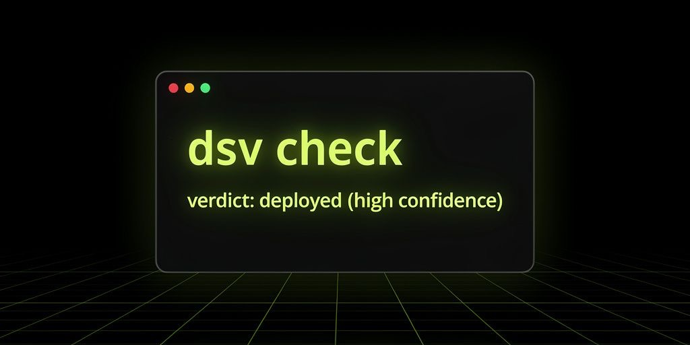
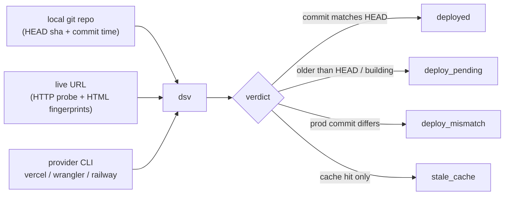
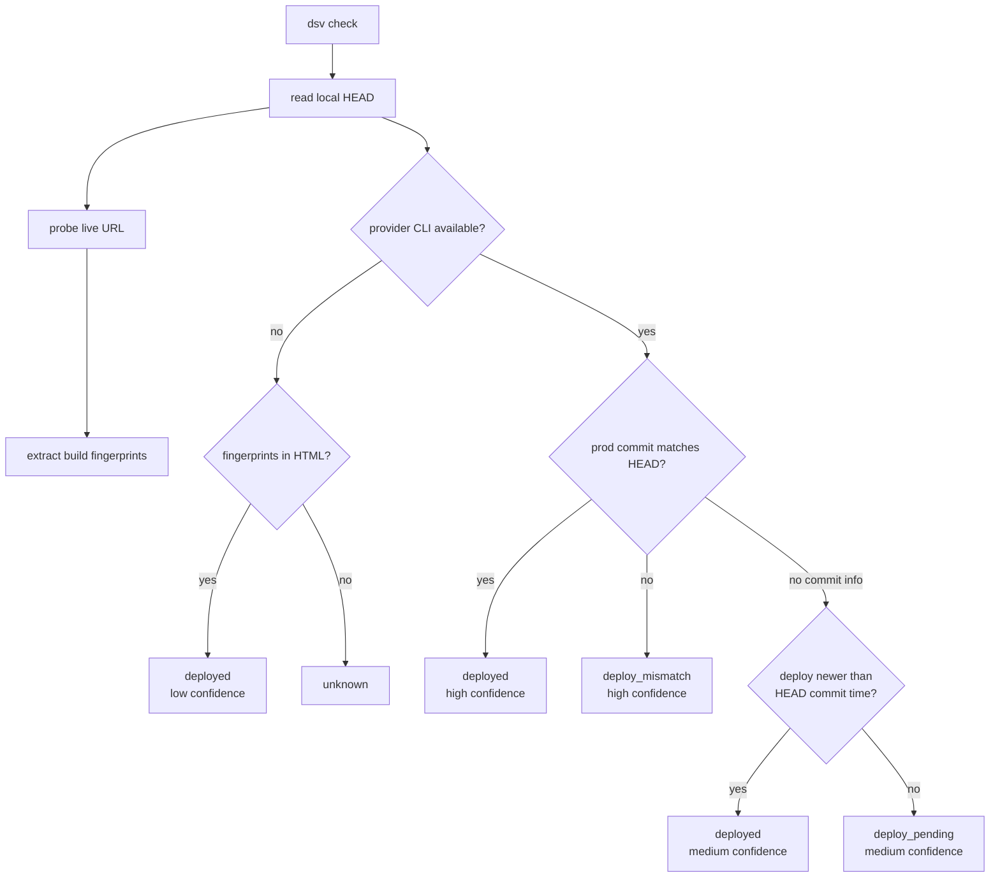
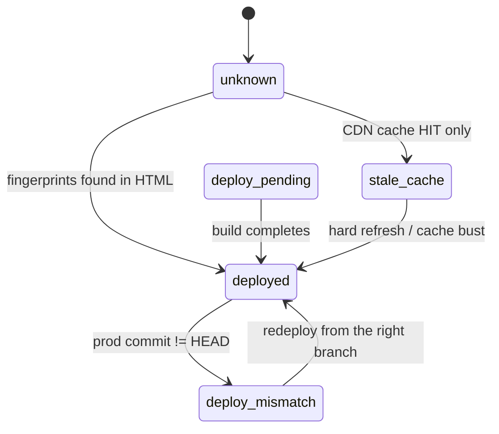

# deploy-sha-verify

<p align="center">
  
</p>

**Did your deploy actually ship?**

`dsv` compares your local git HEAD against the live deployment on **Vercel**,
**Cloudflare Pages**, or **Railway** and tells you, with a confidence level,
whether prod has your latest commit — or whether you're staring at a stale
CDN cache, a pending build, or a deploy that silently went sideways.

No more "I pushed it, why isn't it live?" guessing. One command, an exit code
your CI can gate on, and a human-readable verdict.

## How it works



Three inputs, one decision. `dsv` probes the live site, asks the provider
what it actually deployed, compares both against your local HEAD, and lands
on a single verdict — from strongest signal to weakest.

## Install

```bash
pip install deploy-sha-verify   # not on PyPI yet — install from source:
pip install git+https://github.com/DevvGwardo/deploy-sha-verify.git
```

Requires Python 3.10+. For provider details you also need the provider CLI
on your PATH and logged in:

| Provider         | CLI        | Login                    |
|------------------|------------|--------------------------|
| Vercel           | `vercel`   | `vercel login`           |
| Cloudflare Pages | `wrangler` | `wrangler login`         |
| Railway          | `railway`  | `railway login`          |

## Usage

```bash
# From inside a linked repo (auto-detects provider)
dsv check --url https://play.example.com

# Explicit repo + provider
dsv check --url https://app.example.com --repo ~/my-app --provider vercel

# JSON for cron/CI
dsv check --url https://app.example.com --json

# Just show the latest deployment
dsv ls --repo ~/my-app
```

Use it in CI to fail a job when prod silently drifted:

```bash
dsv check --url https://app.example.com --repo . --json || echo "deploy drifted!"
```

## Exit codes

| Code | Meaning |
|------|---------|
| 0    | Prod looks fresh — deploy landed |
| 1    | Stale signals — cache, deploy older than HEAD, or commit mismatch |
| 2    | Setup error — bad URL, not a git repo, network failure, missing CLI |

## How it decides

Diagnostic ladder, strongest signal first:



1. **Provider-reported git commit vs local HEAD** — `vercel ls` exposes the
   deployed commit SHA. If it matches your HEAD: `deployed`, high confidence.
   If it doesn't: `deploy_mismatch`, high confidence.
2. **Timestamp heuristic** — no commit info? Compare the deployment's created
   time against your HEAD commit time.
3. **Provider state** — BUILDING / QUEUED / ERROR → `deploy_pending`.
4. **Build fingerprints in prod HTML** — Vite `index-*.js`, Next.js `buildId`,
   `/_next/static/` hashes. Weakest signal, only used when the provider check
   is unavailable.

### Verdict states



Every verdict other than `deployed` / `unknown` ships with a concrete
suggested fix, printed right under the verdict in the CLI output.

## Provider detection

`dsv` auto-detects the provider from the repo:

- `.vercel/project.json` → Vercel
- `wrangler.toml` → Cloudflare Pages
- `railway.json` / `.railway/` → Railway

Override with `--provider` if you host on a different provider than the repo
suggests (monorepos with multiple linked projects, etc.).

## Development

```bash
python3 -m venv .venv
.venv/bin/pip install -e . pytest
.venv/bin/python -m pytest
```

## License

MIT
